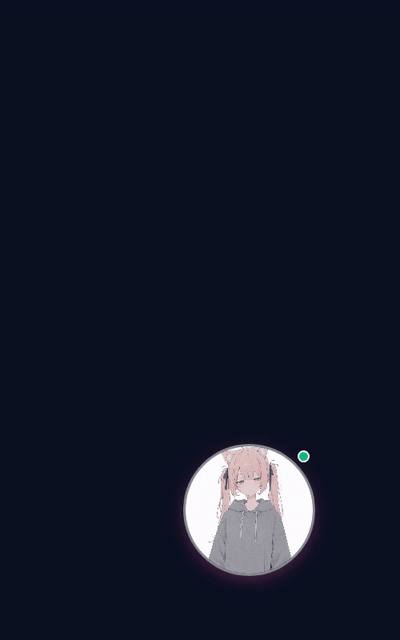

# 猫娘 · 桌面虚拟女友与 Qwen3.5 微调

<p align="center">
  
</p>

一个住在桌面上的虚拟女友，以及一套用来塑造她说话方式的开源微调数据与流程。

她透明、无边框、始终置顶，点一下就能聊天；推理全部走你自己机器上的 `llama-server`。仓库同时包含 Qwen3.5-4B 的训练数据、LoRA 配置记录和图文混采管线。

<p align="center">
  
</p>

<p align="center"><sub>实际录制：拖动 → 展开面板 → 本地 Qwen 回复。思考时立绘会变化，正文在生成完成后整条出现。</sub></p>

## 目录

- [桌面客户端](#桌面客户端)
- [模型与微调](#模型与微调)
- [仓库结构](#仓库结构)
- [开发与检查](#开发与检查)
- [已知限制](#已知限制)

## 桌面客户端

### 功能

- **待在桌面上**：圆形立绘、透明背景、无系统边框，始终置顶，可拖到任意位置。
- **四种状态**：待机、思考、说话、离线，分别使用独立立绘。
- **随时聊天**：点立绘展开面板，支持多轮上下文、打断回复和历史滚动。
- **本地推理**：连接 `llama-server` 的 OpenAI 兼容接口，不依赖云端服务。
- **像聊天软件一样出现消息**：等待时只显示思考状态，回复完成后一次性出现完整气泡。
- **本地存档**：设置、对话历史和立绘位置保存在本机，关闭后不会丢。

### 快速开始

#### 1. 启动模型服务

需要一份支持 Qwen3.5 的 `llama-server` 和自行准备好的 GGUF 权重。仓库不包含模型文件；下面使用 9B 推理模型演示，微调产物换成自己的 GGUF 即可。

```bash
llama-server \
  -m /path/to/Qwen3.5-9B-Q4_K_M.gguf \
  --mmproj /path/to/mmproj-Qwen3.5-9B-f16.gguf \
  --alias qwen3.5-9b \
  --host 127.0.0.1 \
  --port 8080
```

- `--alias` 是客户端“模型别名”中要填写的名字。
- 使用 llama-server 的模型 router 时，请在客户端的设置里选择已经加载的模型，不要只依赖默认第一项。
- 只要实现 `/v1/models` 和流式 `/v1/chat/completions`，其他兼容服务也可以接入。

#### 2. 启动桌面端

需要 Node.js `^20.19` 或 `>=22.12`、Rust stable 和 Tauri 的 Linux 系统依赖。Debian / Ubuntu：

```bash
sudo apt install libwebkit2gtk-4.1-dev libgtk-3-dev libsoup-3.0-dev \
  libjavascriptcoregtk-4.1-dev libayatana-appindicator3-dev
```

然后：

```bash
cd catgirl
npm install
npm run tauri dev
```

第一次启动后，在对话面板的「设置」里确认 llama-server 地址和模型别名。

#### 3. 打包

```bash
npm run tauri build
```

Linux 产物位于 `catgirl/src-tauri/target/release/bundle/`，默认生成 deb 包。

### 操作

| 操作 | 效果 |
|---|---|
| 左键点立绘 | 展开 / 收起对话面板 |
| 拖动立绘 | 移动窗口，位置自动保存 |
| `Ctrl+M` | 展开 / 收起面板（窗口需有焦点） |
| 鼠标滚轮 | 查看更早的聊天记录 |
| `Enter` | 发送消息 |
| `Shift+Enter` | 输入换行 |
| `Esc` | 打断正在生成的回复 |
| 托盘菜单 | 显示 / 隐藏猫娘，或退出 |

右键菜单和点击穿透没有界面入口。回复生成期间按钮会变成「停止」。

### 设置

在对话面板顶部切换到「设置」：

- **llama-server 地址**：默认 `http://127.0.0.1:8080`。
- **模型别名**：留空时使用 `/v1/models` 返回的第一个模型。
- **使用训练语料的猫娘人设**：默认开启。
- **采样参数**：temperature、top_p、repeat_penalty、最长回复 token。
- **外观与行为**：字体大小、立绘透明度、动画开关、空闲自动收起时间。
- **清除聊天记录**：只删除本机历史，不影响模型。

人设原文来自 [`database/system_prompt.txt`](database/system_prompt.txt)，客户端推理直接使用这份文本。

### 常见问题

**状态点是红色，或者提示连不上服务**

确认 `llama-server` 正在运行，地址和端口一致，并且允许跨源访问。改完设置后发送一条消息即可重新确认。

**模型已经加载，但回复是空的**

客户端默认关闭 Qwen 的思考输出（`reasoning_effort: none`）。如果服务端忽略该参数，思考内容可能占满回复预算；提高「最长回复 token」，或在服务端关闭 reasoning。

**窗口出现了但看不到内容**

请用 `npm run tauri dev` 运行，或使用 `npm run tauri build` 的完整产物。直接运行未嵌入前端资源的 debug 二进制时，它需要同时启动 Vite。

**Linux 上托盘图标不可见**

托盘使用 AppIndicator，需要桌面环境支持。XFCE 下已实测；GNOME 可能需要扩展。

## 模型与微调

### 基座：Qwen/Qwen3.5-4B-Base

架构 `Qwen3_5ForConditionalGeneration`，`transformers` 格式，bf16 共 **4.66B 参数 / 9.32GB**。文本侧 hidden 2560、FFN 9216、32 层 = **24 × linear_attention（Gated DeltaNet）+ 8 × full_attention**、vocab 248320、`tie_word_embeddings=true`。

逐张量实测分组（直接读 safetensors 头，不是反解；合计 4659.9M / bf16 9.32GB）：

| 模块 | 参数量 | bf16 | 训练时的处理 |
|---|---|---|---|
| FFN ×32 | 2264.9M | 4.53GB | 4-bit |
| full_attn ×8 | 293.6M | 0.59GB | 4-bit（`attn_output_gate=true`，q_proj 是 2560→8192） |
| DeltaNet ×24 | 1011.4M | 2.02GB | **8-bit，不上 4-bit** |
| embed（tied，无独立 lm_head） | 635.7M | 1.27GB | bf16 常驻；4-bit 会直接压到词表输出分布 |
| visual（blocks 302.3 + merger 27.3 + pos 2.4 + patch 1.6） | **333.6M** | 0.67GB | **bf16 加载并冻结**，不量化、不挂 LoRA |
| mtp ×1 | 120.6M | 0.24GB | 加载时被忽略，不是本方案的选择项 |

`-Base` **也是多模态模型**。视觉塔是否进入训练只取决于加载类；本仓库的路线是保住看图能力，因此视觉塔 bf16 冻结常驻，下节显存预算已包含这部分。

下载（9.34GB）：

```bash
export MODEL_ROOT=/path/to/models
export HF_ENDPOINT=https://hf-mirror.com      # 直连 huggingface.co 不通时
export HF_HUB_DISABLE_XET=1                   # 镜像不代理 Xet 通道
hf download Qwen/Qwen3.5-4B-Base --local-dir "$MODEL_ROOT/Qwen3.5-4B-Base"
```

权重和图文数据集放在仓库外，不入库；人设语料在 `database/`。

### 训练配置

| 项 | 值 |
|---|---|
| adapter | LoRA r=16 fp32，挂在 attn + FFN，不动 DeltaNet |
| 优化器 | AdamW fp32，lr 1e-4，cosine，warmup 3% |
| 前向 | bf16 + gradient checkpointing，ctx 2048，bsz 1，accum 16 |

8GB 单卡显存预算：

| 项 | 显存 |
|---|---|
| 基座（4-bit 2558.5M + 8-bit 1011.4M + embed bf16） | 3.56GB |
| 视觉塔 + merger（bf16 冻结） | +0.67GB |
| LoRA 权重 + 梯度（21.2M × 2 × fp32） | 0.17GB |
| AdamW m + v | 0.17GB |
| bf16 激活（ctx 2048 / bsz 1 / grad ckpt） | ~1.2GB |
| 反量化工作区 + CUDA context | ~0.9GB |
| **峰值合计** | 图文路线 **~6.7GB**，纯文本路线 **~6.0GB** ／ 上限 8GB |

### 数据

**人设语料** [`database/train.jsonl`](database/train.jsonl)：1,652 条微信短聊。assistant 回复按气泡组织，气泡之间用 `\n\n`（Qwen3.5 单 token，id 271）连接；1–4 个气泡，单气泡占 41.96%、双 41.30%、三 16.60%、四 0.14%；emoji 18.5%、问句结尾 26.5%、猫娘口癖 23.26%、`long` 4.0%。来源为 A/B 改写 801、NekoQA 551、新写会话 300，覆盖 20 个中文场景；固定 system 740 字，各条逐字一致。每条另有一条 8–24 字的隐藏 CoT（平均 10.9；规则允许 8–40），对应最后一条 gpt 回复，字段为顶层 `cot`；NekoQA 已压到 33.35%，低于 40% 上限。CoT 由 `finetune/mix_dataset.py` 编码成 Qwen3.5 的 `<think>` 段，客户端只显示正文。

格式、气泡规则与场景标签见 [`database/README.md`](database/README.md)、[`SPEC.md`](database/SPEC.md)。重建与校验（确定性 seed=42，会重写 `train.jsonl`；缺 CoT 的候选会被明确丢弃并打印数量）：

```bash
python3 database/tools/build_wechat.py --from accepted --drop-missing-cot
```

**图文锚点**：为防止纯文本 SFT 改掉视觉通路，另使用三个仓库外数据集（合计约 4.2GB）：

| 数据集 | 体量 | 备注 |
|---|---|---|
| `llava-instruct-mix-vsft` | 2/20 训练分片 1.09GB（25,916 条全量口径）+ 全部 test 分片 0.57GB / 13,640 条 | test 分片作视觉漂移评测集 |
| `LLaVA-OneVision-Data/llava_wild_4v_12k_filtered` | 0.49GB / 7,562 条 | 单图 image struct + conversations |
| `LLaVA-OneVision-Data/ureader_cap` | 2.29GB / 4,813 条 | 仓库标 `language:zh`，实测 0% 含中文 |

**图文混采** [`finetune/mix_dataset.py`](finetune/mix_dataset.py) 把人设文本与图文行归一成一个 encoding：`input_ids / labels / attention_mask / mm_token_type_ids / pixel_values / image_grid_thw`，assistant-only loss，按轮次粒度截断，`--ratio` 控制图文占比（默认 33%）。它会把文本行的 `cot` 按 Qwen3.5 `<think>` 模板编码，开头 `<think>\n` 不监督。

```bash
python finetune/mix_dataset.py --text merged --text-cap 60 --image-cap 20
```

`persona_hook()` 目前是恒等函数，图文答案保持原文。中文图文数据和训练入口仍未定稿。

## 仓库结构

| 路径 | 说明 |
|---|---|
| `catgirl/` | Tauri + TypeScript 桌面客户端 |
| `catgirl/docs/demo.gif` | 桌面端演示 |
| `database/` | 唯一训练集（1,652 条微信短聊）、蒸馏/合并管道、原始数据归档 |
| `finetune/` | 图文混采与格式转换管道 |
| `modelfiles/` | 旧版 Ollama Modelfile，桌面端已不使用 |
| `AGENTS.md` | 窗口实现、数据陷阱、实测记录等开发笔记 |

客户端目录：

```text
catgirl/
├── src/                 前端：聊天、设置、立绘状态与窗口交互
├── src-tauri/           Tauri / Rust 壳、权限和窗口配置
├── public/assets/moods/ 四张状态立绘
├── docs/demo.gif        演示
└── index.html
```

## 开发与检查

```bash
cd catgirl
npm run typecheck   # TypeScript 类型检查
npm run build       # 构建前端到 dist/
npm run dev         # 浏览器预览，Tauri 窗口 API 会跳过
npx tauri dev       # 桌面窗口

cd src-tauri
cargo check
cargo fmt --check
```

更底层的窗口约束、WebKitGTK 注意事项、数据编码陷阱和实机测试记录见 [`AGENTS.md`](AGENTS.md)。

## 已知限制

- Linux 客户端只在 X11 / XFCE 上完整验证；Wayland、多屏和高 DPI 仍需实机确认。
- 托盘图标和托盘菜单需要人工点击，暂未纳入自动测试。
- 桌面端当前只发送文本，尚未提供图片上传入口。
- 训练入口脚本尚未加入仓库，LoRA → 合并 → GGUF → llama-server 的导出一环仍未验证。
- `modelfiles/Modelfile` 仍指向上一版 GGUF，且桌面端已经不再走 Ollama。

## 许可

[MIT](LICENSE)
